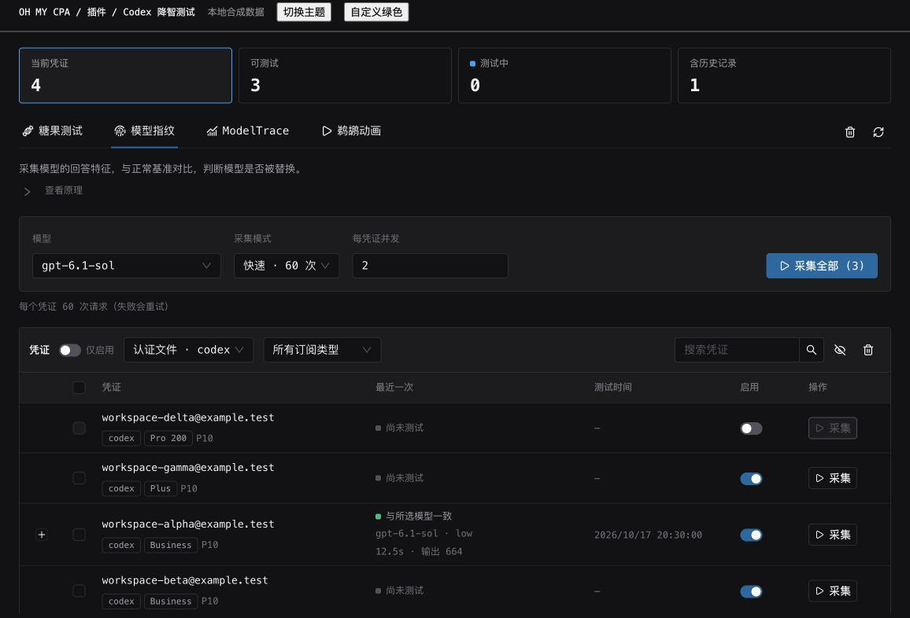
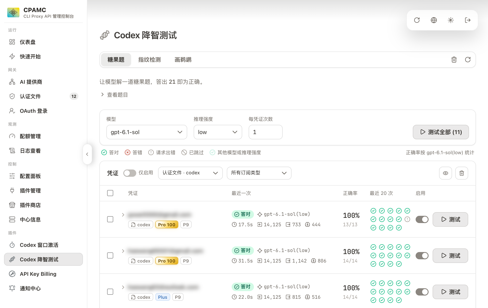

# Codex Candy Eval · OMC Edition

基于 [haowang02/cpa-plugin-codex-candy-eval](https://github.com/haowang02/cpa-plugin-codex-candy-eval) 的 OMC 界面分支，保留上游 MIT 许可及测试能力。

- 使用 OMC 同款 React 18 + Ant Design 6 组件：按钮、选择器、输入框、标签页、表格、开关、进度条、弹窗和提示。
- 直接复用 OMC 的 `createThemeConfig`、`StatTiles` 和 `StatusLabel` 源码，保留其 MIT 许可。
- 自动跟随 OMC 的深浅色、自定义配色和字体；独立页面跟随系统主题。
- 同步上游 v0.4.0 的糖果题、指纹检测、画鹈鹕三种测试，保留当前筛选范围的凭证概览。旧指纹与 ModelTrace 已移除，升级前请备份历史文件；糖果题和鹈鹕记录仍兼容。
- 插件 ID 为 `omcpa-codex-candy-eval`，与原版 `cpa-codex-candy-eval` 独立，可同时加载；接口、测试记录和浏览器偏好分别保存。

从旧 OMC 版本升级：自 `v0.4.0-omc.3` 起使用独立 ID。安装新插件后，旧版配置和历史文件不会被自动修改。需要迁移记录时，先确认两边都没有运行测试，再将 `plugins/cpa-codex-candy-eval-state.json` 复制到 `plugins/omcpa-codex-candy-eval-state.json`，然后加载新插件；已有新历史时不要覆盖。定时巡检脚本也需将插件接口改为新 ID。

验证：`npm ci --prefix web`、`npm --prefix web run check`、`npm --prefix web run build`、`node scripts/test-react.mjs`、`node scripts/test-components.cjs`、`node scripts/test-theme.cjs`、`go vet ./...`、`go test -race ./...`。

本地预览：`node scripts/preview.cjs`，打开 `http://127.0.0.1:4178`；使用本地合成凭证和 API 模拟服务，不连接生产 CPA。

[组件来源与构建说明](docs/omc-ui.md)



[浅色预览](docs/images/omc/light.jpg) · [手机预览](docs/images/omc/mobile.jpg)

生产安装需要替换共享库并由宿主重新加载插件。仓库的 `scripts/deploy.sh` 会重启 CPA，执行前必须获得当前任务明确授权。界面预览和测试使用本地合成数据。

---

# 降智测试（CLIProxyAPI 插件）

在 [CLIProxyAPI](https://github.com/router-for-me/CLIProxyAPI) 管理面板中用**糖果题**、**指纹检测**和**画鹈鹕**测试 Codex 凭证。



## 安装

### CPA 版本要求

最低要求 CPA [v7.3.3](https://github.com/router-for-me/CLIProxyAPI/releases/tag/v7.3.3)。

### 插件商店

CPA 管理面板（CPAMC 或 CPAMP）插件商店搜索安装 `omcpa-codex-candy-eval`，并在面板左侧打开「降智测试」。

### 人工安装

进入 CPA 工作目录，执行对应的安装命令。macOS 和 Linux：

```sh
curl -fsSL https://raw.githubusercontent.com/Yorick-Ryu/cpa-plugin-codex-candy-eval/main/install.sh | sh
```

Windows 请先停止 CPA，再在 PowerShell 中运行：

```powershell
irm https://raw.githubusercontent.com/Yorick-Ryu/cpa-plugin-codex-candy-eval/main/install.ps1 | iex
```

也可以从 [Releases](https://github.com/Yorick-Ryu/cpa-plugin-codex-candy-eval/releases/latest) 下载对应平台的压缩包，解压后将插件文件重命名为 `omcpa-codex-candy-eval-v<版本号>.<扩展名>`，放入对应的 `plugins/<系统>/<架构>/` 目录。

在 CPA 的 `config.yaml` 中启用插件：

```yaml
plugins:
  enabled: true
  dir: "plugins"
  configs:
    omcpa-codex-candy-eval:
      enabled: true
```

## 使用

在「凭证」标题右侧选择类型，默认「认证文件 · codex」，也可选择「全部凭证」。点击凭证旁的按钮单独测试，或勾选多个凭证批量测试。未勾选时，批量操作针对当前类型下的全部可用凭证。

### 糖果题

选择模型、推理强度和每凭证次数，点击「测试」。推理强度选择 `none` 时由 CPA 决定。

正确答案为 **21**。展开凭证可查看历次回答，正确率按当前选择的模型和推理强度统计。

### 指纹检测

选择模型，点击凭证旁的「测试」，或勾选凭证批量测试。插件从参考库的 36 道数字挑战中随机抽取 3 道，与参考库中的模型比对，显示最接近的模型、家族及归因概率。测试 gpt-6.1-sol 时命中 gpt-6-astra/6.1-sol，测试 deepseek-flash 时命中 deepseek-v4.1-flash-1017，均视为一致。展开凭证可查看历史记录和详情。

### 画鹈鹕

选择模型和推理强度，点击「测试」。模型会写出一个用 SVG 绘制鹈鹕骑自行车动画的 HTML 页面。列表和历史记录显示动画的缩略画面，点击即可放大播放。

### 记录与额度

- 测试会消耗凭证额度。每次请求都以新会话的完整 Codex CLI 上下文发出，输入约 1.4 万 Token。
- 每个凭证的每种测试都保留最近 20 次记录，刷新或重启后仍可查看。
- 点击标签栏右侧的垃圾桶可清空全部测试记录；凭证列表右上角的垃圾桶只清空当前测试的记录。
- 单次请求有时间限制：指纹检测 3 分钟，糖果题和画鹈鹕 10 分钟。超时的请求会被中断。

### 定时巡检

巡检脚本定时用糖果题测试账号，默认跳过 Free 订阅。每个账号先测一次，状态变化须经两次复测确认；降智账号恢复前的复测等待 240 秒。开启自动调整后，脚本改变 priority，并通过 ntfy 或 Bark 通知恢复或降智。部署方法见 [定时糖果巡检](docs/inspection.md)。

也可以补全下面的提示词，发给 Codex、Claude Code 等 AI 助手，让它帮你部署：

```text
请按照 https://raw.githubusercontent.com/Yorick-Ryu/cpa-plugin-codex-candy-eval/main/docs/inspection.md 中的教程，在这台机器上部署降智测试插件的定时巡检。

我的配置（没写的项保持脚本默认值）：
- CPA 地址：
- CPA 管理密钥：
- 巡检频率：（例如每 30 分钟）
- 糖果测试模型和推理强度：（例如 gpt-6.1-sol、low）
- 巡检范围：（例如所有 codex- 开头的认证文件）
- 是否自动调整 priority：（是或否，可指定降智和正常账号的 priority）
- 通知方式：（ntfy 的服务器地址、主题和账号密码，Bark 的推送地址，或不通知）

部署后先手动运行一次，确认巡检能正常完成，再配置 crontab，最后告诉我日志的位置。缺少必要信息时先问我。
```

## 致谢

- [codex-candy-eval](https://github.com/haowang02/codex-candy-eval)
- [LM Fingerpoint Detector](https://github.com/Ikaleio/lm-detector) — 指纹检测使用的数字指纹归因算法与参考库（MIT）
- [LINUX DO](https://linux.do/) - 新的理想型社区
